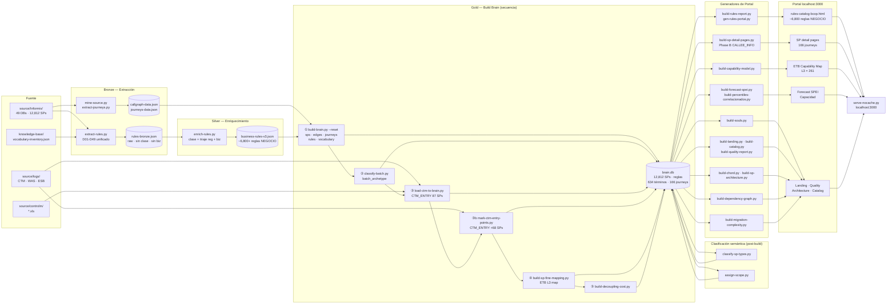

# Pipeline — Informix Digital Brain (BCOPBrain)

## Arquitectura Medallion — Rules Pipeline (Bronze → Silver → Gold)

```
[source/Informix/  ·  49 DBs  ·  ~12,812 SPs]
[knowledge-base/vocabulary-inventory.json]
              │
              ▼
   extract-rules.py          ← BRONZE  (D01-D49 unificado, vocab-anchored)
              │                 Detecta: FÓRMULA / VALIDACIÓN / UMBRAL / ESTADO
              │                 Aplica: reg/riesgo patterns + BC tagging
              ▼
   portal/data/rules-bronze.json   (raw: sin business_name, sin clase asignada)
              │
              ▼
   enrich-rules.py           ← SILVER  (clasificación clase + triaje reg + biz)
              │                 Aplica: clase (NEGOCIO/INFRA/ENSAMBLAJE/PRESENTACION)
              │                 Aplica: regulatory domain defaults D17-D49
              │                 Copia: business_name desde brain.db (si existe)
              ▼
   portal/data/business-rules-v3.json  {"meta":..., "rules":..., "stats":...}
              │
              ▼
   build-brain.py --reset     ← GOLD   (load_rules() → brain.db)
              │
              ▼
   brain.db (reglas correlacionadas con journeys, términos y SPs)
```

Scripts archivados en `generators/old/`:
- `extract-rules-v2.py` — supersedido por extract-rules.py (D01-D16)
- `extract-rules-d17-d49.py` — supersedido por extract-rules.py (D17-D49)
- `enrich-d17-d49.py` — lógica absorbida en enrich-rules.py
- `triaje-d17-d49.py` — lógica absorbida en enrich-rules.py
- `ola-a/b/c/d-*.py` — operaban sobre `terms` (vocabulario); pipeline separado

---

## Pipeline Completo (Mermaid)



---

## Comandos canónicos de rebuild completo

```bash
# ── Bronze: extracción unificada D01-D49 ─────────────────────────────────────
python generators/extract-rules.py
# Output: portal/data/rules-bronze.json

# ── Silver: enriquecimiento (clase + reg defaults + biz desde brain.db) ───────
python generators/enrich-rules.py
# Output: portal/data/business-rules-v3.json

# ── Gold: rebuild brain ───────────────────────────────────────────────────────
python digital-brain/build-brain.py --reset
python digital-brain/classify-batch.py
python generators/load-ctm-to-brain.py
python generators/mark-ctm-entry-points.py
python generators/build-sp-fine-mapping.py     # opcional · ~30 min
python generators/build-decoupling-cost.py

# ── Generadores del portal ────────────────────────────────────────────────────
python generators/gen-rules-portal.py          # rules-catalog-bcop.html
python generators/build-sp-detail-pages.py    # SP detail pages

# ── Servidor local ────────────────────────────────────────────────────────────
# (desde raíz BanCoppel/)
python -m http.server 3000
# http://localhost:3000/systems/core/Informix/portal/
```

---

*Actualizado: 2026-08-25 · Medallion Architecture (Bronze/Silver/Gold) consolidada.*
*Scripts archivados: extract-rules-v2.py, extract-rules-d17-d49.py, enrich-d17-d49.py, triaje-d17-d49.py, ola-a/b/c/d-*.py → generators/old/*
